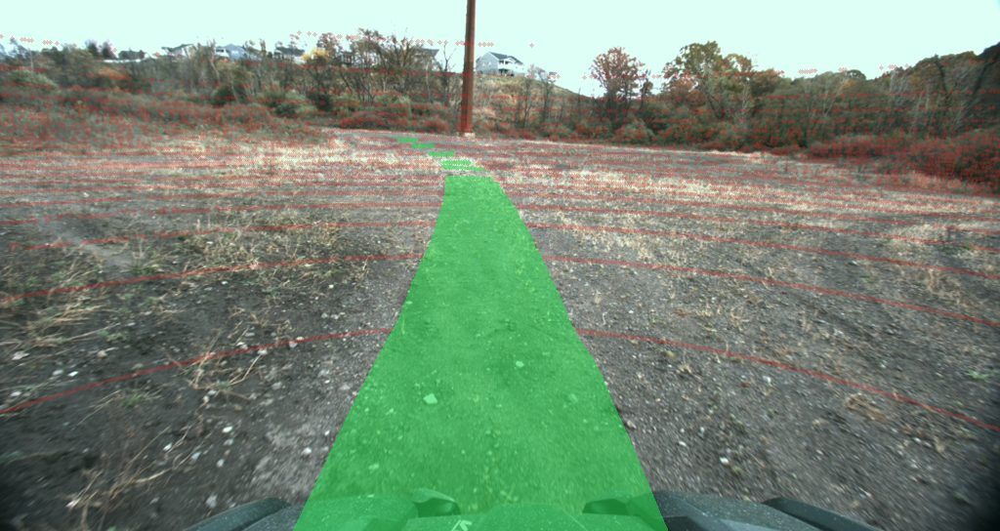

# apairo-huggingface

Raw **TartanDrive v2** rosbags → **self-supervised traversability labels** →
a **LeRobotDataset** ready for policy training on the Hub.

This repo is the worked example of the
[apairo](https://github.com/apairo-robotics/apairo) stack: it contains no
loader, no sync code and no geometry of its own — the labeling is a ~100-line
composition of
[`apairo_preprocess`](https://github.com/apairo-robotics/apairo_preprocess)
primitives, and the export is ~17 lines of channel→feature naming.



## Published on the Hub

| Repo | Format | Status |
|---|---|---|
| [`apairo-robotics/tartandrive_offroad`](https://huggingface.co/datasets/apairo-robotics/tartandrive_offroad) | LeRobotDataset | live — 55 episodes / 123,786 frames |
| `apairo-robotics/tartandrive_offroad_eval` | plain `datasets.Dataset` | not yet published — pipeline ready, see [`docs/eval_benchmark.md`](docs/eval_benchmark.md) |

## The pipeline

```
rosbags ──apairo_extractor──▶ .apairo layout (channels, timestamps, calibration)
        ──apairo-tartan-label──▶ trav_traj · lidar_uv · trav_mask   [derived channels]
        ──apairo-tartan-export──▶ LeRobotDataset: image · mask · pose · action
```

### 1. Label — where the robot drove is free ground truth

Per lidar scan, three `apairo_preprocess` preprocessors compose
([`labeling.py`](src/apairo_huggingface/labeling.py)):

| Stage | Primitive | Output channel |
|---|---|---|
| points inside the future robot footprint, look-ahead capped at 40 m of *path* | `TraversabilityFromTrajectory` | `trav_traj` (N,) |
| scan → rectified left camera, row-aligned `[u, v, depth]` | `LidarCameraProjection` | `lidar_uv` (N, 3) — opt-in (`--keep-uv`), recomputable |
| labels splatted nearest-depth-wins + z-buffer, then the **driven corridor** rasterized as occlusion-checked filled quads | `ImageMaskFromPointLabels` + corridor | `trav_mask` (H, W) — grayscale PNG, loader `img` |

The corridor is what makes the mask *dense*: the footprint ribbon interpolated
along the future trajectory fills the whole driven passage instead of a set of
lidar rings. Labels are conservative by construction — `1` is *demonstrated*
traversability (the platform drove there), `0` marks the projected lidar
points (measured, no label information — hence the ring pattern), `255` is
unobserved.

The rig (rectified multisense `P`, vehicle→optical extrinsic) lives in
[`calibration.py`](src/apairo_huggingface/calibration.py) with its provenance;
it reduces to `ds.calibration.get_intrinsics()` / `get_tf()` once the
recordings carry a `cameras:` calibration section. Channels persist via
`ChannelWriter` in bounded memory and register in `.apairo`, so they load like
any raw channel.

### 2. Export — no bespoke domain code

apairo already loads, aligns and cuts the asynchronous multi-rate recordings;
the per-frame value ops are `apairo_transform` callables and the frame is pure
naming:

| LeRobot feature | ← channel | transform |
|---|---|---|
| `observation.images.front` | `image_left_color` (H×W×3 uint8) | as-is (identity) |
| `observation.traversability_mask` | `trav_mask` (H×W uint8) | replicate to RGB — lossless `image`, mp4 would corrupt labels |
| `observation.state` | `gps_odom` | `ChannelSelect(range(7))` → pose, `CastTo(float32)` |
| `action` | `cmd` | `CastTo(float32)` → `[linear_velocity, angular_velocity]` |

The lidar *produces* the labels; it is not part of the published dataset.

## Use

```bash
# 1. Label: write the derived channels on every recording.
#    Needs per-scan poses (gicp_poses; else run apairo_preprocess.KissICPOdometry).
apairo-tartan-label --root /path/to/tartan

# 2. Validate the read pipeline only — no lerobot, no writes.
apairo-tartan-export --dry-run --root /path/to/tartan

# 3. Build the LeRobotDataset locally, or push to the Hub (`huggingface-cli login`).
apairo-tartan-export --no-push --root /path/to/tartan
apairo-tartan-export --repo-id <user>/tartandrive_offroad --root /path/to/tartan
```

Or as a library:

```python
from apairo_huggingface import label_root, load_tartan, to_lerobot

label_root("/path/to/tartan")
dataset = to_lerobot(load_tartan("/path/to/tartan"), "me/tartandrive_offroad", push=True)
```

`--root` accepts a TartanDrive **root** (many recordings → many episodes) or a
**single** sequence directory (→ one episode); it also reads `APAIRO_TARTAN_ROOT`.

## Layout

```
src/apairo_huggingface/
  config.py      channels, sync + labeling params, task, feature dims
  calibration.py the TartanDrive rig: rectified intrinsics + velodyne→camera tf
  labeling.py    trajectory traversability -> trav_traj / lidar_uv / trav_mask
  mappings.py    channel transforms (ChannelSelect / CastTo) + frame naming
  features.py    build_features — the LeRobot schema, sized from a real frame
  export.py      to_lerobot() — the reusable sink; validate() — the dry-run
  eval_labeling.py  ground_truth (toaster) -> trav_mask_gt, projected the same way as trav_mask
  eval_export.py    trav_mask_gt + raw points -> a plain HF dataset (not LeRobot; see docs/)
  cli.py         apairo-tartan-label · apairo-tartan-export · apairo-tartan-gt-label · apairo-tartan-gt-export
examples/
  export_tartan_to_lerobot.py   thin, linear entry point
  load_tartan_views.py          the same raw data as lidar / IMU / windowed / DataLoader views
hub/
  dataset_card.md               the Hub dataset card, ready to upload
docs/
  eval_benchmark.md             sequence selection + publishing design for the hand-labeled benchmark
tests/
  conftest.py       synthetic TartanDrive fixture (geometry matches the real rig)
  test_labeling.py  channels written + registered, label semantics, idempotence
  test_export.py    dry-run + export + reload round-trip
  test_eval.py      ground-truth projection + eval dataset round-trip
```

## FoMo: seasonal traversability (in progress)

[FoMo](https://fomo.norlab.ulaval.ca) (Forêt Montmorency, CC BY 4.0) recorded the
same forest trails twelve times between November 2024 and November 2025, snow
included, and serves them from a public S3 bucket. `apairo_huggingface.fomo` turns it into a
LeRobotDataset with self-supervised traversability masks:

- `fomo_bin`, an apairo **format plugin** for FoMo's packed 26-byte lidar records;
- a declaration (`fomo/apairo.yaml`) reading the tree as published -- RoboSense
  scans, Basler images and the ~50 Hz twist commands, each on its own clock;
- KISS-ICP odometry, scored against FoMo's GNSS-PPK `gt.txt` (ATE);
- masks computed **at the camera instant**: `synchronize()` picks the nearest
  scan and interpolates the pose at the image timestamp, and the scan is moved
  by the motion between the two before projection;
- the export: image (video), mask (lossless PNG), pose in `base_link`, command
  as `action`, snow depth and air temperature per episode.

`fomo/calibration.py` documents two traps in the shipped calibration (the
Basler intrinsics and the frame of the lidar-camera extrinsic), both checked by
projecting scans onto images.

```bash
apairo-fomo list --color red                       # 12 trajectories, 12-32 GB each
apairo-fomo run --root ~/data/fomo --color red --drop-lidar
apairo-fomo export ~/data/fomo --out ~/data/fomo_lerobot             # local build
apairo-fomo export ~/data/fomo --out ~/data/fomo_lerobot --push      # to the Hub
```

`run` downloads, then processes, one trajectory at a time and skips those with
an `apairo_fomo_report.json`, so it resumes after an interruption.
`--drop-lidar` deletes the scans once labelled (the export does not need them).
On a 22-core laptop, one trajectory takes ~8 min of odometry, 2 min of scan
labels and 5 min of masks, plus the download.

## RELLIS-3D: lidar labels and traversability in every image (in progress)

[RELLIS-3D](https://github.com/unmannedlab/RELLIS-3D) (CC BY-NC-SA 3.0)
annotates 13556 Ouster scans point by point, but only 6235 camera images.
Every scan is co-captured with an image, so `apairo_huggingface.rellis`
projects the scan labels into **all** 13556 images, adds a traversability mask
from the driven trajectory, and measures how well the projected labels agree
with the official 2D annotations:

- `semkitti_label`, an apairo **format plugin** for SemanticKITTI `.label` files;
- a declaration (`rellis/apairo.yaml`) reading a sequence as published; scans
  and labels borrow the camera clock (the filenames carry the stamp). The source
  tree is read through a symlink view, so nothing is written into it;
- `sem_mask` (ontology id, 255 = no lidar point) and `trav_mask`
  (1 driven / 0 seen, not driven / 255 no data) for every image;
- `apairo-rellis agreement`: per-class IoU against the official 2D labels,
  only where the projection has data;
- the export: image (video), both masks and the official 2D label (lossless
  PNG), pose, executed motion as `action`, official lidar split per frame.

`rellis/calibration.py` documents the calibration chain and its traps (an
extrinsic stored as the camera pose, to be inverted; rectified images, so no
distortion), each checked by scoring projections against the 2D annotations.

```bash
apairo-rellis process   --root /data/rellis --out ~/data/rellis_derived    # all 5 sequences
apairo-rellis agreement --root /data/rellis --out ~/data/rellis_derived
apairo-rellis overlay ~/data/rellis_derived/00003 --every 500 --png-dir /tmp/overlays
apairo-rellis export ~/data/rellis_derived 00003 --root /data/rellis --lerobot-root ~/data/rellis_lerobot
```

The derived dataset inherits RELLIS-3D's **non-commercial, share-alike**
license.

## RELLIS-3D: robot-centred BEV grids (elevation, semantic, traversability)

RELLIS-3D has no bird's-eye-view labels, yet top-down grids are what planners
consume. `apairo_huggingface.rellis.bev` builds three grids for **every scan**,
centred on that scan's pose, as apairo **derived channels** (one
`FramePreprocessor` with three `output_keys`, materialised by
`run_preprocess`, recipe-hashed so an unchanged rerun is a no-op):

| channel | per frame | values |
|---|---|---|
| `bev_elevation` | `(3, 200, 200)` float16 | min / max / mean height above the ground under the robot (m), NaN unknown |
| `bev_semantic` | `(200, 200)` uint8 | majority ontology id of the points in the cell (void only if alone), 255 unknown |
| `bev_trav` | `(200, 200)` uint8 | 1 driven / 0 seen, not driven / 255 unknown |

Design choices (all in `rellis/config.py`, "BEV grids"):

- **Grid**: 0.2 m cells, 40 x 40 m, forward-biased: 30 m ahead, 10 m behind,
  20 m either side. Gravity-aligned frame: origin at the lidar, +x the robot
  heading (the Ouster's -x) projected on the ground plane, +y left, z world up.
  Row 0 is 30 m ahead, column 0 is 20 m left: the robot drives up the image.
- **Heights** are lidar z + 1.0 m (the measured lidar height), so the ground
  under the robot reads ~0.
- **Accumulation, past only**: the grid of scan j uses scans j, j-2, ..., j-18
  (10 scans, ~2 s, ~2.6 m at the median 1.3 m/s), placed with `poses.txt`.
  Nothing later than j enters the inputs (a test rewrites the future scans and
  checks the grid does not move). Moving objects (people walking beside the
  robot) smear over those 2 s.
- **Self-returns**: points within 2 m, and a sensor-frame box 0-3 m behind the
  lidar (robot-attached returns, mostly labelled void, present in most scans)
  are dropped. The lowest Ouster beam meets the ground ~3.4 m out, so a disc
  around the robot stays unknown.
- **Traversability** is a label and may use the future: the robot footprint
  (0.7 m either side of the path) from 10 m of path behind the scan to 30 m
  ahead. Driven cells are 1 even where no point fell; seen cells (any point)
  are 0 otherwise; frames with less than 10 m of path ahead are all 255, as
  in the image masks.
- **Clock**: scans have no stamp; the view's `poses` channel (the symlinked
  `poses.txt`, read by apairo's `csv` format) gets a `timestamps.txt` written
  once from the camera filenames, and the scans and labels borrow it -- no
  image is decoded to process a sequence.

`apairo-rellis bev-quality` checks the two independent sources against each
other: the share of driven cells whose majority class is driveable (dirt,
grass, asphalt, concrete, puddle, mud), the share that is an obstacle (tree,
bush, barrier, person, ...), and the driveable share of seen-not-driven cells
as the base rate.

```bash
apairo-rellis bev-process --root /data/rellis --out ~/data/rellis_bev      # all 5 sequences
apairo-rellis bev-render ~/data/rellis_bev/00003 --every 500 --png-dir /tmp/bev
apairo-rellis bev-quality --out ~/data/rellis_bev
apairo-rellis bev-export ~/data/rellis_bev --root /data/rellis --lerobot-root ~/data/rellis_bev_lerobot
apairo-rellis bev-check ~/data/rellis_bev_lerobot
```

The export is a separate LeRobotDataset (one episode per sequence, one frame
per scan): the camera image at 480x300 (video), `observation.bev.elevation`
(float32, NaN unknown -- LeRobot's per-element statistics are NaN for it, so
mask before normalising), `observation.bev.semantic` and `observation.bev.trav`
(lossless PNG, the id in every channel), plus the pose, action and frame info
of the image export. It is written locally only.

## Install

```bash
python -m venv .venv && source .venv/bin/activate
pip install -e ../apairo -e ../apairo_preprocess   # sibling repos, editable
pip install -e ".[test]"                           # this package + lerobot>=0.4.0
```

With `uv`, `apairo_preprocess` pins `apairo-transform` to its git URL, which
conflicts with an editable sibling; override it:

```bash
printf "apairo-transform @ file://$PWD/../apairo_transform\napairo @ file://$PWD/../apairo\n" > /tmp/overrides.txt
uv pip install --override /tmp/overrides.txt -e ../apairo -e ../apairo_transform -e ../apairo_preprocess -e ".[test]"
```

> Note: `apairo_preprocess` and `apairo_transform` install editable from the `../` siblings for now, pending their own PyPI publishing.

## Getting the data

TartanDrive v2 ships as ROS bags. Two steps bring them into the apairo layout
this pipeline reads.

**1. Download the bags.** Upstream ships a GUI downloader that pulls one sequence
at a time. This fork adds an interactive terminal client that lets you pick
**modalities × sequences and download them all in one pass**:

```bash
git clone https://github.com/augustin-bresset/tartan_drive_2.0
cd tartan_drive_2.0
pip install -r requirements.txt   # TartanDrive download dependencies
python scripts/tartan_cli.py      # interactive client: choose modalities + sequences, download in bulk
```

Pick the **rosbag** distribution — *not* the pre-converted KITTI one. apairo turns
bags into its native layout directly, keeping `/tf`, static calibration and each
channel's `frame_id` that the KITTI export flattens away.

**2. Extract to apairo format** with
[apairo_extractor](https://github.com/apairo-robotics/apairo_extractor), which
reads ROS bags and writes the `.apairo` sidecars (`channels.yaml`, calibration
from `/tf_static`) — ready for `TartanKittiDataset` / `RawDataset`:

```bash
pip install -e ../apairo_extractor

apairo extractor      # launches the interactive TUI in the terminal
```

The TUI walks you through it: point it at your rosbag directory, pick the topics
to extract (left colour camera, lidar, GPS odometry, drive command — plus `/tf`
/ `/tf_static` for poses and calibration) and the output path. The result feeds
straight into `apairo-tartan-label` via `--root`.

## Beyond the export: many views of the same raw data

The LeRobot export is one slice of the recordings — the camera clock with mask,
pose and command attached. Changing `keys=` and `reference=` re-slices the same
apairo dataset into other views with no new loader code: lidar-clock perception,
IMU-rate dynamics, causal windows for action chunking, or a direct PyTorch
`DataLoader`. See [`examples/load_tartan_views.py`](examples/load_tartan_views.py)
(runs against apairo's `mini_tartan` fixture).

## Hand-labeled evaluation benchmark

A held-out set of hand-labeled frames (via
[toaster](https://github.com/augustin-bresset/toaster)) to evaluate models
with real traversable/obstacle negatives, not just the self-supervised
`trav_mask`. Sequence selection and the publishing design are in
[`docs/eval_benchmark.md`](docs/eval_benchmark.md); labeling the target
sequences is in progress.

```bash
# 1. Import toaster's raw export as a 'ground_truth' apairo channel (lives in
#    apairo_experiments/scripts/import_toaster_gt.py, one sequence at a time).

# 2. Project the per-point labels into the camera -> trav_mask_gt.
apairo-tartan-gt-label --root /path/to/tartan

# 3. Build the eval benchmark (image + mask + raw points/labels) locally or push it.
apairo-tartan-gt-export --dry-run --root /path/to/tartan
apairo-tartan-gt-export --repo-id <user>/tartandrive_offroad_eval --root /path/to/tartan
```

This is a **plain `datasets.Dataset`**, not a LeRobotDataset: it's a curated
frame subset (not a continuous trajectory) and its point cloud is
ragged (LeRobotDataset features need one fixed shape). See
[`docs/eval_benchmark.md`](docs/eval_benchmark.md) for why.
