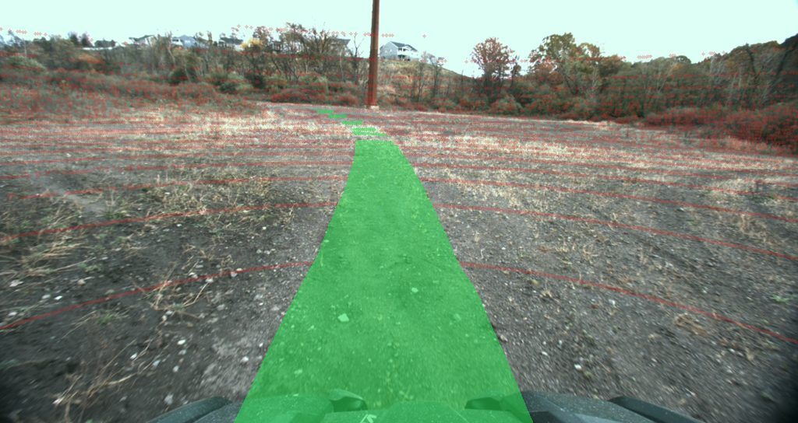

# TartanDrive Off-Road Traversability — LeRobotDataset

> **This dataset is a demonstration of a data pipeline.** All 55 episodes /
> ~124k frames were generated from raw, *asynchronous* TartanDrive 2.0 rosbags —
> **including a per-pixel traversability ground truth that does not exist in
> the raw data**: it is derived, self-supervised, from where the robot actually
> drove. The conversion is **~17 lines of channel→feature mapping** plus a
> ~100-line labeling composition of
> [`apairo_preprocess`](https://github.com/apairo-robotics/apairo_preprocess)
> primitives. Everything hard — loading multi-rate sensors, time-aligning them,
> cutting episodes, projecting between sensors — is done by
> [**apairo**](https://github.com/apairo-robotics/apairo) and its satellites.
> The interesting part isn't the data, it's *how little, and how clearly, it
> takes to get there.*

## The entire conversion

TartanDrive is an **asynchronous, multi-rate sensor rig**: camera, GPS odometry
and drive commands each tick on their own clock, one channel per file. LeRobot
wants the opposite — synchronous, per-episode frames with every modality
aligned. That gap is normally where a pile of brittle glue code lives.

apairo closes it on the read side, and the per-frame value ops are **standard
[`apairo_transform`](https://github.com/apairo-robotics/apairo_transform)
callables** — cast the command, take the pose out of the odometry row, leave the
image untouched — chained onto the synchronized view, so there is **no bespoke
domain code left**:

```python
import numpy as np
from apairo import TartanKittiDataset, Compose
from apairo_transform import CastTo, ChannelSelect   # library transforms

frames = (TartanKittiDataset(root, keys=["image_left_color", "gps_odom", "cmd"])
          .synchronize(reference="image_left_color",       # multi-rate → camera clock
                       method="nearest", tolerance=0.05)
          .transform("gps_odom", Compose([ChannelSelect(range(7)),  # pose out of Odometry
                                          CastTo(np.float32)]))
          .transform("cmd", CastTo(np.float32)))            # image_left_color: as-is
```

The whole export is then *load → align → copy → finalize*, because apairo
already did the loading, resampling and episode segmentation, and the frame is
pure naming:

```python
for recording in tartan.sequences:              # one recording = one episode
    for sample in aligned_frames(recording):    # the synchronized+transformed view above
        dataset.add_frame({
            "observation.images.front": sample.data["image_left_color"],
            "observation.state":        sample.data["gps_odom"],
            "action":                   sample.data["cmd"],
            "task": "drive off-road",
        })
    dataset.save_episode()
dataset.finalize()
```

No timestamp-matching loop, no per-sensor resampling, no episode bookkeeping,
and no custom transform code — `synchronize()` resamples every channel onto the
camera clock (nearest within ±50 ms) and the value ops are library callables.
Full source: [`mappings.py`](https://github.com/apairo-robotics/apairo_huggingface/blob/main/src/apairo_huggingface/mappings.py).

**Full source, all open:**
[apairo_huggingface](https://github.com/apairo-robotics/apairo_huggingface)
(the exporter above) ·
[apairo](https://github.com/apairo-robotics/apairo) (the data layer) ·
[apairo_extractor](https://github.com/apairo-robotics/apairo_extractor)
(rosbags → `.apairo` layout). Reproduce with:

```bash
apairo-tartan-export --repo-id <you>/tartandrive_offroad --root /path/to/tartan
```

## What's in it

```python
from lerobot.datasets.lerobot_dataset import LeRobotDataset

dataset = LeRobotDataset("apairo-robotics/tartandrive_offroad")
frame = dataset[0]
frame["observation.images.front"]           # (H, W, 3) front camera
frame["observation.traversability_mask"]    # 1 driven / 0 lidar-seen, no info / 255 unobserved
frame["observation.state"]                  # [x, y, z, qx, qy, qz, qw] pose
frame["action"]                             # [linear_velocity, angular_velocity]
```

| Feature | Shape | Source (TartanDrive channel) |
|---|---|---|
| `observation.images.front` | (H, W, 3) uint8 video | `image_left_color` — left colour camera |
| `observation.traversability_mask` | (H, W, 3) uint8 image | `trav_mask` — derived; `1` driven (traversable), `0` lidar return **without traversability information** (not an obstacle label), `255` unobserved |
| `observation.state` | (7,) float32 | `gps_odom` — pose `[x, y, z, qx, qy, qz, qw]` |
| `action` | (2,) float32 | `cmd` — `[linear_velocity, angular_velocity]` |

- **fps**: 10 (camera clock) · **robot_type**: `tartandrive` (Yamaha Viking ATV)
  · **task**: `drive off-road`
- 55 recordings → 55 episodes, 123,786 synchronized frames.
- The mask is stored as lossless PNG (`image`), not mp4 (`video`): compression
  must not corrupt label values. Single channel replicated to RGB; read any one.
- The lidar *produces* the labels; it is not part of the published dataset.

## The traversability channel



Where the robot drove is free ground truth. Per camera frame, on the nearest
lidar scan:

1. **Points** — lidar points inside the robot footprint swept along the
   *future* trajectory are traversable
   (`TraversabilityFromTrajectory`, look-ahead capped at 40 m of path so a
   looping trajectory cannot label distant terrain);
2. **Projection** — the scan projects into the rectified left camera
   (`LidarCameraProjection`; intrinsics = the multisense `P`, extrinsics
   composed from the upstream `extrinsics.yaml`);
3. **Mask** — point labels splat with nearest-depth-wins and a coarse z-buffer
   (`ImageMaskFromPointLabels`), then the **driven corridor** — the footprint
   ribbon interpolated along the future path — is rasterized on top as filled
   quads, occlusion-checked against the lidar returns.  The labeled passage is
   dense, not a set of lidar rings.

Labels are conservative by construction: `1` is *demonstrated* traversability
(the platform drove there); `255` is unobserved.  **`0` carries no
traversability information**: it marks a lidar return the platform did not
drive over — flat, perfectly drivable ground the robot simply did not visit is
`0` exactly like a tree trunk is (which is why `0` traces the sensor's ring
pattern).  Do not read `0` as an obstacle class: treat it as
*measured-but-unlabeled* (a positive-unlabeled setting) unless you derive your
own negatives, e.g. from point height above ground.  Reproduce with
`apairo-tartan-label --root ...`;
the primitives are
[`apairo_preprocess`](https://github.com/apairo-robotics/apairo_preprocess),
the composition is
[`labeling.py`](https://github.com/apairo-robotics/apairo_huggingface/blob/main/src/apairo_huggingface/labeling.py).

## One raw dataset, many views

This LeRobotDataset is **one** slice of the raw recordings — the camera clock,
with pose and command attached. The same apairo dataset re-slices into other
views by changing `keys=` and `reference=`, again with no new loader code:

```python
from apairo import TartanKittiDataset

# Perception / terrain mapping: lidar clock, point clouds + nearest command
lidar = (TartanKittiDataset(root, keys=["velodyne_0", "cmd"])
         .synchronize(reference="velodyne_0", method="nearest", tolerance=0.1))
lidar[0].data["velodyne_0"]         # (N, 3) point cloud

# Vehicle dynamics: IMU clock (~10x the camera rate), no images to decode
dyn = (TartanKittiDataset(root, keys=["multisense_imu", "cmd"])
       .synchronize(reference="multisense_imu", method="nearest", tolerance=0.02))

# Action chunking / world models: causal windows over any view
chunks = dyn.window(size=8, reduce=stack, boundary="drop")
chunks[0].data["cmd"]               # (8, 2) command sequence

# Training: every view is already a torch-compatible Dataset
loader = torch.utils.data.DataLoader(dyn, batch_size=32, collate_fn=collate)
```

Each view is lazy (indices at construction, reads on access) and slots straight
into a `DataLoader` — or back into the exporter to publish as another
LeRobotDataset like this one. The single-slice-here / many-slices-there gap is
exactly the point: LeRobot fixes one schema, apairo yields as many as there are
uses.

## Source data

TartanDrive 2.0 was collected at Carnegie Mellon University's AirLab with a
modified Yamaha Viking ATV driven aggressively across diverse off-road terrain.
This export uses the **rosbag** distribution (not the pre-converted KITTI one),
keeping `/tf`, static calibration and per-channel `frame_id` intact.

## Citation

If you use this dataset, please cite TartanDrive 2.0:

```bibtex
@inproceedings{sivaprakasam2024tartandrive,
  title={TartanDrive 2.0: More Modalities and Better Infrastructure to Further Self-Supervised Learning Research in Off-Road Driving Tasks},
  author={Sivaprakasam, Matthew and Maheshwari, Parv and Castro, Mateo Guaman and Triest, Samuel and Nye, Micah and Willits, Steve and Saba, Andrew and Wang, Wenshan and Scherer, Sebastian},
  booktitle={IEEE International Conference on Robotics and Automation (ICRA)},
  year={2024}
}
```

## License

The original [TartanDrive dataset](https://theairlab.org/tartandrive-dataset/)
is explicitly released under
[CC BY 4.0](http://creativecommons.org/licenses/by/4.0/). TartanDrive 2.0 does
not state a separate data license (its repository's MIT license covers the
code); this conversion is published under CC BY 4.0 accordingly, with full
attribution to the AirLab authors above. The conversion code
([apairo_huggingface](https://github.com/apairo-robotics/apairo_huggingface))
is MIT.
