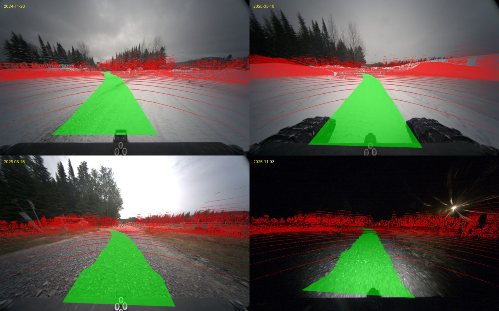

# FoMo Multi-Season Traversability - LeRobotDataset

> **A derived dataset.** Twelve repetitions of the same ~300 m "red" route in
> the Foret Montmorency boreal forest, recorded once per deployment from
> November 2024 to November 2025 (bare ground, snow over 1 m, summer, night),
> converted to a LeRobotDataset with **a per-pixel traversability ground truth
> that does not exist in the raw data**: it is derived, self-supervised, from
> where the robot actually drove. Everything else (loading the multi-rate
> sensors, aligning their clocks, lidar odometry, projecting between sensors)
> is done by [**apairo**](https://github.com/apairo-robotics/apairo) and its
> satellites.



*Green: `1`, the driven corridor. Red: `0`, lidar points that were seen but
not driven. Untouched pixels: `255`, no data.*

## What's in it

```python
from lerobot.datasets.lerobot_dataset import LeRobotDataset

dataset = LeRobotDataset("apairo-robotics/fomo_traversability")
frame = dataset[0]
frame["observation.images.front"]           # (3, 600, 960) Basler camera
frame["observation.traversability_mask"]    # (3, 600, 960) 1 driven / 0 seen, not driven / 255 no data
frame["observation.state"]                  # [x, y, z, qx, qy, qz, qw] pose, relative to the episode start
frame["observation.environment"]            # [snow_depth_m, air_temperature_c]
frame["action"]                             # [linear_velocity, angular_velocity] command
```

| Feature | Shape | Source |
|---|---|---|
| `observation.images.front` | (600, 960, 3) uint8 video | `basler` - Basler wide-lens camera, 1920x1200 raw (distorted, not rectified), downscaled by 2 |
| `observation.traversability_mask` | (600, 960, 3) uint8 image | `trav_mask` - derived, see below; single channel replicated to RGB |
| `observation.state` | (7,) float32 | `kissicp_poses` - KISS-ICP lidar odometry, SE(3)-interpolated at the image timestamp, expressed in `base_link` (+x forward) relative to the first frame of the episode |
| `observation.environment` | (2,) float32 | `metadata/snow_data.csv`, `metadata/meteo_data.csv` - trajectory means of snow depth (m) and air temperature (degC); `NaN` where the station did not log |
| `action` | (2,) float32 | `metadata/cmd_velocity.csv` - twist command in force at the image instant (forward m/s, yaw rad/s) |

- **fps**: 10 (Basler clock) - **robot_type**: `clearpath_warthog` -
  **task**: `drive the robot along the forest trail`
- 12 trajectories -> 12 episodes, 28,268 frames.
- The mask is stored as lossless PNG (`image`), not mp4 (`video`): video
  compression would corrupt the label values. Read any one channel.
- The lidar *produces* the labels and the poses; it is not part of the
  published dataset.
- Frames within the last 10 m of path are dropped (no corridor ahead to label).

### Mask values

| Value | Meaning |
|---|---|
| `1` | **driven**: inside the robot footprint (1.4 m wide) swept along the *future* trajectory, up to 30 m of path ahead. Demonstrated traversability. |
| `0` | **seen, not driven**: a projected lidar return outside the driven footprint. Measured, but carries no traversability label (it is *not* "non-traversable"); hence the ring pattern. |
| `255` | **no data**: neither driven nor hit by a lidar return. |

Labels are conservative by construction: absence of `1` means "not
demonstrated", never "untraversable". Across the 12 trajectories, about 9 % of
pixels are `1`, 10 % are `0` and 81 % are `255`.

## Episodes

One episode per trajectory, in date order. `path_m` and the ATE come from
`apairo_fomo_report.json`: KISS-ICP positions are SE(3)-interpolated at every
GNSS-PPK ground-truth stamp (`gt.txt`), rigidly aligned (Umeyama, no scale),
and compared. `gt_stamps` is the number of GNSS stamps scored.

| Episode | Trajectory | Frames | path_m | gt_stamps | ATE RMSE (m) | ATE max (m) | Snow (m) | Air (degC) |
|---|---|---|---|---|---|---|---|---|
| 0 | `2024-11-21/red_2024-11-21-10-34` | 2,452 | 325 | 1,269 | 0.150 | 0.49 | 0.00 | 3.3 |
| 1 | `2024-11-28/red_2024-11-28-09-30` | 2,157 | 312 | 1,125 | 0.158 | 0.52 | n/a | -2.8 |
| 2 | `2025-01-10/red_2025-01-10-12-02` | 3,740 | 320 | 3,833 | 0.147 | 0.58 | 0.50 | -5.9 |
| 3 | `2025-01-29/red_2025-01-30-09-58` | 3,014 | 321 | 3,166 | 0.103 | 0.44 | 0.85 | -24.0 |
| 4 | `2025-03-10/red_2025-03-10-16-53` | 1,916 | 315 | 2,106 | 0.195 | 0.42 | 1.06 | -6.4 |
| 5 | `2025-04-15/red_2025-04-15-51-56` | 4,485 | 321 | 4,609 | 0.145 | 0.61 | n/a | n/a |
| 6 | `2025-05-28/red_2025-05-28-10-46` | 1,829 | 298 | 1,927 | 0.157 | 0.44 | 0.00 | 21.4 |
| 7 | `2025-06-26/red_2025-06-26-10-31` | 1,739 | 304 | 1,824 | 0.173 | 0.36 | n/a | n/a |
| 8 | `2025-08-20/red_2025-08-20-10-42` | 1,824 | 304 | 1,931 | 0.191 | 0.69 | 0.00 | 18.1 |
| 9 | `2025-09-24/red_2025-09-24-10-45` | 1,703 | 303 | 1,815 | 0.195 | 0.44 | 0.00 | 14.7 |
| 10 | `2025-10-14/red_2025-10-14-11-41` | 1,606 | 306 | 1,690 | 0.211 | 0.60 | 0.00 | 14.2 |
| 11 | `2025-11-03/red_2025-11-03-18-30` | 1,803 | 302 | 1,922 | 0.152 | 0.59 | 0.00 | 1.8 |

KISS-ICP drift stays at 0.10-0.21 m RMSE over ~300 m on every deployment,
snow included, so the corridor is placed on the camera image by the odometry
alone.

### Known issues

- **2025-01-29 (`red_2025-01-30-09-58`, -24 degC): the camera images are
  saturated.** Every sampled Basler frame of this trajectory is white
  (mean intensity 255, >98 % of pixels saturated). The masks are valid lidar
  geometry, but the RGB observation carries no information. Drop episode 3 for
  any image-based use.
- **2025-11-03 is a night run**: the scene is lit by the robot's headlights
  only (mean image intensity ~24/255). The masks are unaffected.
- **Tracked configuration** (2025-01-10, 2025-03-10): the Warthog runs on
  tracks that are visible at the bottom of the image, and the near end of the
  corridor is drawn over them (the vehicle's own body is not masked out).
- `observation.environment` is `NaN` on 2024-11-28 (snow depth), 2025-04-15
  and 2025-06-26 (both values): the weather station did not log those fields.
  Snow depth is the raw logger mean and can be very slightly negative in
  summer (sensor noise, about -0.002 m); the table above clips it at 0.
- LeRobot `timestamp` is `frame_index / fps`. A camera frame with no lidar scan
  within 50 ms has no mask and is skipped, so a few real gaps are hidden:
  about 50 frames (0.2-0.3 s each) on 2025-04-15, 5 on 2025-11-03, 1 on
  2025-01-29, none elsewhere.

## How the masks are built

Where the robot drove is free ground truth. On FoMo the Basler camera and the
RoboSense Ruby Plus lidar (128 rings, ~10 Hz) run on their own triggers, so the
mask is computed **at the camera instant**, not borrowed from the nearest scan:

1. **Odometry** - KISS-ICP on the deskewed RoboSense scans (per-point time)
   gives one `T_world_lidar` per scan (`kissicp_poses`).
2. **Point labels** - lidar points inside the robot footprint swept along the
   future trajectory are traversable (`TraversabilityFromTrajectory`,
   look-ahead capped at 30 m of path, height window around the ground)
   -> `trav_traj`, on the lidar clock.
3. **Image mask** - for each Basler frame, `synchronize()` picks the nearest
   scan (within 50 ms) and *interpolates* the pose at the frame's own stamp;
   the scan is moved by the motion between the two instants, projected
   through the distorted Basler model (`LidarCameraProjection`), splatted with
   nearest-depth-wins (`ImageMaskFromPointLabels`), and the **driven
   corridor** - the footprint ribbon along the future path - is rasterized on
   top as filled quads, occlusion-checked against the lidar returns
   -> `trav_mask`, on the camera clock.

Calibration notes (both found by projecting scans onto images and checked
against road edges, fences and the tree line): the Basler intrinsics are the
FoMo SDK's distorted model (f = 376 px, plumb-bob), not the undistorted
`calib/basler.json` shipped with each trajectory; and the `robosense -> basler`
entry of `calib/transforms.json` is expressed in a `base_link`-oriented frame,
which is rotated by 180 degrees about z from the RoboSense sensor frame.

The primitives are
[`apairo_preprocess`](https://github.com/apairo-robotics/apairo_preprocess);
the composition is
[`fomo/labeling.py`](https://github.com/apairo-robotics/apairo_huggingface/blob/feature/fomo/src/apairo_huggingface/fomo/labeling.py).

## Reproduce

The FoMo tree is read as-is through an apairo declaration passed at load time
(`fomo/apairo.yaml`, plus a `fomo_bin` format plugin for the RoboSense scans);
only the derived channels and apairo's `.apairo/` registry are written into
it.

```bash
pip install "apairo-huggingface @ git+https://github.com/apairo-robotics/apairo_huggingface@feature/fomo"

# fetch + odometry + labels + ATE, for the red trajectory of every deployment
apairo-fomo run --root /data/fomo --color red --drop-lidar

# one LeRobotDataset, one episode per trajectory
apairo-fomo export /data/fomo --repo-id apairo-robotics/fomo_traversability --out /data/fomo_lerobot
```

The export itself is a synchronized view on the mask clock, and the frame is
pure naming:

```python
sync = RawDataset(traj, declare=declaration(),
                  keys=["trav_mask", "basler", "cmd_velocity", "kissicp_poses"]
                  ).synchronize(reference="trav_mask",
                                method={"basler": "nearest",           # the mask's own image
                                        "cmd_velocity": "previous",    # the command in force
                                        "kissicp_poses": Se3Interp()}, # the pose at the image instant
                                tolerance=0.15)
```

**Source, all open:**
[apairo_huggingface](https://github.com/apairo-robotics/apairo_huggingface)
(this exporter, branch `feature/fomo`) -
[apairo](https://github.com/apairo-robotics/apairo) (the data layer,
[doi:10.5281/zenodo.23768995](https://doi.org/10.5281/zenodo.23768995)) -
[github.com/apairo-robotics](https://github.com/apairo-robotics).

## Source data

FoMo (Foret Montmorency) is a multi-season dataset recorded over one year in a
boreal forest by Norlab (Universite Laval) and the University of Toronto
Robotics Institute with a Clearpath Warthog: six trajectories repeated during
12 deployments, over 64 km, with rotating and solid-state lidars, FMCW radar,
cameras, IMUs and GNSS-PPK ground truth. This export uses the **red**
trajectory of each deployment, the RoboSense lidar (to build labels and
poses), the Basler camera, the drive commands and the weather metadata.
Homepage: <https://fomo.norlab.ulaval.ca>.

## Citation

If you use this dataset, please cite FoMo:

```bibtex
@misc{Boxan2026_fomo,
  title         = {{FoMo: A Multi-Season Dataset for Robot Navigation in For\^et Montmorency}},
  author        = {Matej Boxan and Gabriel Jeanson and Alexander Krawciw
                   and Effie Daum and Xinyuan Qiao and Sven Lilge
                   and Timothy D. Barfoot and Francois Pomerleau},
  year          = {2026},
  eprint        = {2603.08433},
  archivePrefix = {arXiv},
  primaryClass  = {cs.RO},
  url           = {https://arxiv.org/abs/2603.08433}
}
```

## License

The FoMo dataset is released under
[CC BY 4.0](https://creativecommons.org/licenses/by/4.0/) (`LICENSE.txt` at
the root of the FoMo S3 bucket). This derived dataset is published under
CC BY 4.0 accordingly, with full attribution to the FoMo authors above.
Changes from the source: images downscaled by 2, traversability masks, poses
and frame selection added by the pipeline described here. The conversion code
([apairo_huggingface](https://github.com/apairo-robotics/apairo_huggingface))
is MIT.
