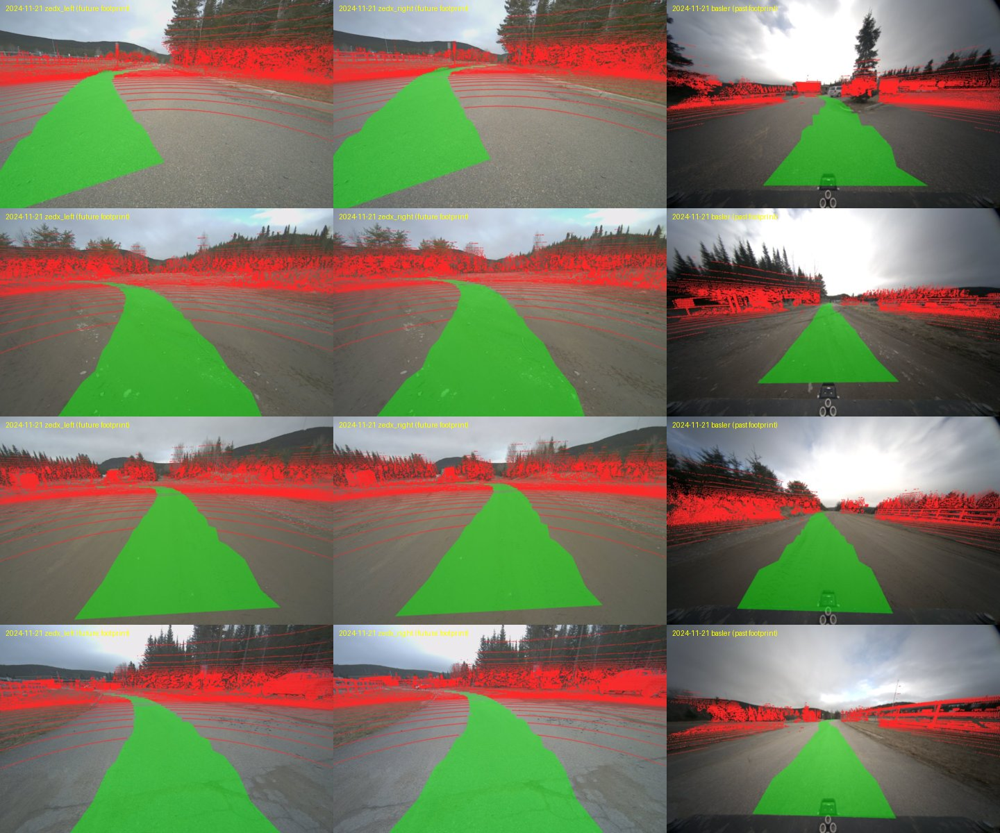

# FoMo Multi-Season Traversability - labels

> **Labels only, one channel per sensor.** Self-supervised traversability
> labels for the twelve "red" trajectories of
> [FoMo](https://fomo.norlab.ulaval.ca) (November 2024 to November 2025, bare
> ground to over 1 m of snow), derived from where the robot actually drove:
> per point for every RoboSense Ruby Plus scan, and per pixel for every frame
> of the three cameras. The sensor data is **not** redistributed (except a
> small preview, see below): every label row is keyed by the raw FoMo file it
> belongs to, so it joins with your own FoMo download. Built with
> [**apairo**](https://github.com/apairo-robotics/apairo).



*Green: `1`, driven. Red: `0`, lidar returns seen, not driven. Untouched:
`255`, no data. TODO: the figure shows the trajectories rebuilt so far;
regenerate it with `scripts/fomo_overlay.py` once all twelve are done.*

## Channels

| Config | Sensor (FoMo dir) | Looks | Label | Key |
|---|---|---|---|---|
| `robosense` | RoboSense Ruby Plus lidar (`robosense/`) | 360 deg | per point: future **and** past driven footprint | `robosense_file` = `<us>.bin` |
| `zedx_left` | ZED X stereo, left (`zedx_left/`) | forward | per pixel: **future** driven footprint | `image_file` = `<us>.png` |
| `zedx_right` | ZED X stereo, right (`zedx_right/`) | forward | per pixel: **future** driven footprint | `image_file` = `<us>.png` |
| `basler` | Basler (`basler/`) | **backward** | per pixel: **past** driven footprint | `image_file` = `<us>.png` |
| `preview` | the three cameras | | half-size raw image with the mask drawn on it, one frame every ~10 s | `camera`, `image_file` |

**Future** footprint: the robot footprint (1.4 m wide) swept along the
trajectory *ahead* of the sensor instant, up to 30 m of path, in a height
window of -0.3/+0.5 m around the ground below the path. **Past** footprint:
the same along the trajectory *behind* it. The Basler faces backward: the
corridor ahead is never in its view, so it carries the past footprint only,
and the forward cameras the future one. `footprint` is a column of every
camera table.

Values: `1` = driven (demonstrated traversable); `0` = a lidar return seen,
not driven (carries no traversability label: it is *not* "untraversable");
`255` = no data (camera masks only). Absence of `1` means "not
demonstrated", never "untraversable".

## Layout

```
robosense/<deployment>/<trajectory>.parquet     # one row per scan
zedx_left/<deployment>/<trajectory>.parquet     # one row per labelled frame
zedx_right/<deployment>/<trajectory>.parquet
basler/<deployment>/<trajectory>.parquet
preview/<deployment>/<trajectory>.parquet       # ~1 frame / 10 s / camera
```

`robosense` columns:

| Column | Type | Meaning |
|---|---|---|
| `trajectory` | string | `<deployment>/<trajectory>`, the FoMo bucket path |
| `scan_stem` | string | `NNNNNN`, the scan's rank in the trajectory (sorted by stamp) |
| `robosense_file` | string | `<us>.bin`, the raw FoMo file under `<trajectory>/robosense/` |
| `timestamp_us` | int64 | the file's microsecond epoch stamp (its name) |
| `n_points` | int32 | points in the raw scan (file size / 26 bytes) |
| `driven_indices` | list<int32> | row indices of the points under the **future** footprint |
| `driven_indices_past` | list<int32> | row indices of the points under the **past** footprint |
| `pose` | 16 x float64 | row-major `T_world_lidar` (KISS-ICP, deskewed; world = the first scan's lidar frame) |

Camera columns: `trajectory`, `camera`, `footprint` (`future` or `past`),
`image_file` (`<us>.png`, the raw FoMo image under `<trajectory>/<camera>/`),
`timestamp_us` (int64), `mask_png` (the 1200 x 1920 uint8 mask as a lossless
PNG, aligned with the raw, distorted, unrectified image). A camera frame
with no lidar scan within 50 ms has no row.

`preview` columns: `trajectory`, `camera`, `footprint`, `image_file`,
`timestamp_us`, `overlay_jpeg` (960 x 600 JPEG of the raw image with the mask
drawn over it), `mask_png` (the full mask, as in the camera tables).

The labels are computed on **every** point of the raw scan, in file order (no
range or ring filtering), so `driven_indices` index the rows of FoMo's
`robosense/<us>.bin` directly.

| Trajectory | Scans |
|---|---|
| `2024-11-21/red_2024-11-21-10-34` | 2,540 |
| `2024-11-28/red_2024-11-28-09-30` | 2,251 |
| `2025-01-10/red_2025-01-10-12-02` | 3,834 |
| `2025-01-29/red_2025-01-30-09-58` | 3,168 |
| `2025-03-10/red_2025-03-10-16-53` | 2,108 |
| `2025-04-15/red_2025-04-15-51-56` | 4,627 |
| `2025-05-28/red_2025-05-28-10-46` | 1,929 |
| `2025-06-26/red_2025-06-26-10-31` | 1,825 |
| `2025-08-20/red_2025-08-20-10-42` | 1,934 |
| `2025-09-24/red_2025-09-24-10-45` | 1,817 |
| `2025-10-14/red_2025-10-14-11-41` | 1,692 |
| `2025-11-03/red_2025-11-03-18-30` | 1,924 |
| **total** | **29,649** |

About 1.3 % of all points (64.7 M of 5.11 billion) are under the future
footprint. The past footprint labels far fewer points (0.13 % on
`2024-11-21`): the RoboSense sees almost no ground right behind the robot,
which its own body hides.

Frames, pixel shares and table sizes per camera, from
`scripts/fomo_card_numbers.py`; only the first trajectory is rebuilt so far,
the others are TODO:

| Trajectory | Camera | Footprint | Listed frames | Masks | % 1 / 0 / 255 | Table MB |
|---|---|---|---|---|---|---|
| `2024-11-21/red_2024-11-21-10-34` | zedx_left | future | 2,537 | 2,536 | 22.0 / 12.6 / 65.4 | 182 |
| `2024-11-21/red_2024-11-21-10-34` | zedx_right | future | 2,537 | 2,536 | 22.7 / 12.6 / 64.7 | 180 |
| `2024-11-21/red_2024-11-21-10-34` | basler | past | 2,540 | 2,538 | 9.4 / 7.3 / 83.3 | 135 |
| the 11 others | all | | TODO | TODO | TODO | TODO |

On that trajectory the tables weigh 13 MB (`robosense`), 182 + 180 + 135 MB
(cameras) and 12 MB (`preview`, 78 frames); the whole dataset size is TODO.
A mask PNG averages 72 KB (ZED X) and 53 KB (Basler): the lidar ring
pattern of the `0` pixels dominates, and run-length coding with zlib was
measured only ~20 % smaller, so the masks stay plain PNG.

## Use with your FoMo download

```python
import io
import numpy as np
import pandas as pd
from PIL import Image

traj = "2024-11-21/red_2024-11-21-10-34"
dep, name = traj.split("/")
masks = pd.read_parquet(f"zedx_left/{dep}/{name}.parquet")
row = masks.iloc[100]
mask = np.asarray(Image.open(io.BytesIO(row.mask_png)))          # (1200, 1920): 1 / 0 / 255
image = np.asarray(Image.open(f"/data/fomo/{traj}/zedx_left/{row.image_file}"))  # your download

RECORD = np.dtype([("x", "<f4"), ("y", "<f4"), ("z", "<f4"), ("i", "<f4"),
                   ("r", "<u2"), ("t", "<u8")])
scans = pd.read_parquet(f"robosense/{dep}/{name}.parquet")
scan = scans.iloc[944]
cloud = np.fromfile(f"/data/fomo/{traj}/robosense/{scan.robosense_file}", dtype=RECORD)
assert len(cloud) == scan.n_points
future = np.zeros(scan.n_points, np.uint8); future[scan.driven_indices] = 1
past = np.zeros(scan.n_points, np.uint8); past[scan.driven_indices_past] = 1
```

With [`apairo_huggingface`](https://github.com/apairo-robotics/apairo_huggingface/tree/feature/fomo)
a downloaded trajectory also loads as an apairo dataset (per-sensor clocks
read from the file names; `fomo_bin` format plugin for the RoboSense files),
and `apairo_huggingface.fomo.point_labels.mask` rebuilds the per-point label.

## How to verify

Everything below is reproducible with one command, which downloads only the
raw files it needs from the public FoMo bucket:

```bash
apairo-fomo verify 2024-11-21/red_2024-11-21-10-34 --labels <this dataset> --n 20 [--rerun]
```

It checks, and prints:

1. **stamps** - the RoboSense files listed in the bucket are exactly the
   labelled scans, and every labelled camera frame is a listed raw image;
2. **n_points** - every listed scan size is 26 x `n_points`, and the
   downloaded scans read back with exactly `n_points` rows;
3. **geometry** - each camera's optical axis against the driving direction
   measured from the label poses (+1 forward, -1 backward);
4. **agreement** - on `n` frames per camera the scan is moved to the image
   instant and projected: the share of driven lidar points (per-point labels
   of the camera's footprint) landing on driven mask pixels, and the share of
   the lidar points on driven pixels that are labelled driven;

and writes one overlay JPEG per checked frame (`--rerun` also logs them to a
running Rerun viewer). Measured on `2024-11-21/red_2024-11-21-10-34`
(`--n 20`):

| Check | Result |
|---|---|
| RoboSense files listed vs labelled scans | 2,540 / 2,540, stamps equal |
| listed sizes = 26 x `n_points` | all 2,540 |
| downloaded scans with exactly `n_points` rows | 20 / 20 |
| driving direction from the poses, lidar frame | (-1.00, 0.02, 0.03) |
| optical axis . driving direction | `zedx_left` 0.94, `zedx_right` 0.94, `basler` -0.97 |
| labelled frames that are listed raw images | `zedx_left` 2,536 / 2,536 (of 2,537 listed), `zedx_right` 2,536 / 2,536 (of 2,537), `basler` 2,538 / 2,538 (of 2,540) |
| driven lidar points on driven pixels (median of 20 frames) | `zedx_left` 0.86, `zedx_right` 0.84, `basler` 0.63 |
| lidar points on driven pixels labelled driven (median) | `zedx_left` 0.96, `zedx_right` 0.97, `basler` 0.77 |

The agreement is lower on the Basler: its past-footprint point labels are
sparse (see above), and its ribbon is drawn behind the robot over ground the
lidar barely sees. The other trajectories: TODO.

## How the labels are built

1. **Odometry** - KISS-ICP on the deskewed RoboSense scans (per-point time,
   2-80 m range for registration only) gives one `T_world_lidar` per scan.
   Drift is 0.10-0.21 m RMSE over ~300 m on every trajectory against FoMo's
   GNSS-PPK ground truth.
2. **Point labels** - every point of the raw scan inside the footprint
   swept along the future trajectory is `1` in `driven_indices`
   (`TraversabilityFromTrajectory` from
   [`apairo_preprocess`](https://github.com/apairo-robotics/apairo_preprocess));
   the same labeler run on the scans in reverse order gives the past
   footprint, `driven_indices_past`.
3. **Camera masks** - for each camera frame (stamps from the bucket listing:
   the pixels are not needed), the nearest scan within 50 ms and its labels
   of the camera's footprint are taken, the pose is *interpolated* at the
   frame's own stamp and the scan moved by the motion between the two
   instants, projected through the camera's distorted model, splatted with
   nearest-depth-wins (`ImageMaskFromPointLabels`), and the footprint ribbon
   along the future (ZED X) or past (Basler) path is rasterized on top,
   occlusion-checked against the lidar returns.

Calibration (`fomo/calibration.py`, checked by projecting raw scans onto
the images - near sign poles, curbs, road edges - and by the KISS-ICP
motion):

- the robot drives along the RoboSense **-x** axis (`base_link -> robosense`
  is a 180 degree yaw);
- the `robosense -> <camera>` entries of `calib/transforms.json` are read
  literally (`T_camera_from_robosense` is their inverse); `zedx_right` is
  chained through `zedx_left -> zedx_right` (0.12 m baseline). Read that way
  the ZED X looks forward and the Basler looks backward;
- the intrinsics shipped in the bucket (`calib/zedx_left.json`,
  `calib/basler.json`) are the same placeholder (f = 738 px, no distortion).
  The raw images match the factory calibrations kept by the FoMo SDK
  (norlab-ulaval/fomo-sdk at `67b74ae`): `zedx_SN41705768.conf` sections
  `[LEFT_CAM_FHD1200]` and `[RIGHT_CAM_FHD1200]` (f = 735 / 737 px,
  plumb-bob), and `basler.json` (f = 376 px, plumb-bob).

```bash
pip install "apairo-huggingface @ git+https://github.com/apairo-robotics/apairo_huggingface@feature/fomo"
apairo-fomo run --root /data/fomo --color red --drop-lidar    # scans only: odometry, labels, masks
apairo-fomo export-labels /data/fomo --out /data/fomo_labels  # robosense/
apairo-fomo export-masks /data/fomo --out /data/fomo_labels   # zedx_left/, zedx_right/, basler/
```

`scripts/fomo_labels_pipeline.py` does the same one trajectory at a time for
a disk that cannot hold every scan, and writes the preview;
`scripts/fomo_card_numbers.py` prints every number of this card from the
data, and `scripts/fomo_overlay.py` draws the figure.

## Known issues

- **2025-01-29 (`red_2025-01-30-09-58`, -24 degC): the Basler is saturated**
  (preview mean intensity and saturated share: TODO, from the pipeline). Its masks are geometric and computed like the others,
  but they cannot be checked against its images. Its ZED X images are fine
  (TODO, from the pipeline).
- **2025-11-03 is a night run**, lit by the robot's headlights only. The
  labels do not depend on the light.
- The vehicle's own body (tracks in 2025-01-10 and 2025-03-10, the rear
  deck in the Basler) is not masked out: the near end of the footprint
  can be drawn over it.
- The ZED X delivers 10 frames per second on average, on a 15 Hz grid
  (consecutive frames 67 or 133 ms apart); masks are computed at each
  frame's own stamp.
- A previous image export (LeRobot, Basler masks) projected the lidar into
  the Basler with a 180-degree-flipped extrinsic; it is withdrawn. These
  tables replace it.
- Not labelled (yet): the Leishen lidar and the Navtech radar of the same
  trajectories, though `calib/transforms.json` gives their extrinsics.

## Citation

If you use these labels, please cite FoMo:

```bibtex
@misc{Boxan2026_fomo,
  title         = {{FoMo: A Multi-Season Dataset for Robot Navigation in For\^et Montmorency}},
  author        = {Matej Boxan and Gabriel Jeanson and Alexander Krawciw
                   and Effie Daum and Xinyuan Qiao and Sven Lilge
                   and Timothy D. Barfoot and Francois Pomerleau},
  year          = {2026},
  eprint        = {2603.08433},
  archivePrefix = {arXiv},
  primaryClass  = {cs.RO},
  url           = {https://arxiv.org/abs/2603.08433}
}
```

## License

The FoMo dataset is released under
[CC BY 4.0](https://creativecommons.org/licenses/by/4.0/) (`LICENSE.txt` at
the root of the FoMo S3 bucket). These derived labels and poses are
published under CC BY 4.0 accordingly, with full attribution to the FoMo
authors above. The `preview` config redistributes a small subset of FoMo
camera images (one frame every ~10 s, downscaled by 2, with the masks drawn
over them), which CC BY 4.0 allows with this attribution; no other FoMo
sensor data is included. The conversion code
([apairo_huggingface](https://github.com/apairo-robotics/apairo_huggingface))
is MIT.
