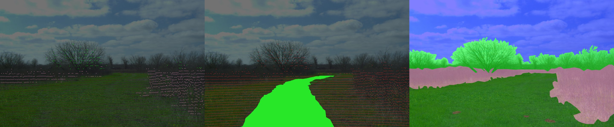

# RELLIS-3D: lidar labels and traversability in every image

RELLIS-3D annotates **13556 Ouster scans** point by point but only **6235
camera images** (6234 PNG annotations in the release tree we used). Every scan is co-captured with an image,
so this dataset projects the scan labels into **all 13556 images**. It also adds
a self-supervised **traversability mask** from where the robot drove, and
measures how well the projected labels agree with the official 2D annotations.
All of it is built with [apairo](https://github.com/apairo-robotics/apairo)
and its satellites. Source: `apairo_huggingface.rellis` (`apairo-rellis`).



## Features (one episode per sequence, 10 Hz)

| feature | content |
|---|---|
| `observation.images.front` | Basler image, 960x600 (video) |
| `observation.semantic_mask` | ontology id of the nearest projected lidar point; **255 = no lidar point** (lossless PNG) |
| `observation.traversability_mask` | 1 = driven, 0 = seen by the lidar but not driven, 255 = no data (lossless PNG) |
| `observation.label_2d` | official 2D annotation (ontology ids); 255 on frames without one |
| `observation.state` | pose `x y z qx qy qz qw`, relative to the episode start, robot frame (+x forward, +z up, origin at the lidar) |
| `observation.frame_info` | `[split, scan_index, has_label_2d]`; split from the official `pt_{train,val,test}.lst` (0/1/2) |
| `action` | executed forward speed (m/s) and yaw rate (rad/s), from the poses (the release has no command topic) |

Masks are 3-channel PNG with the same value in every channel; read channel 0.
They are stored at 960x600 (nearest-neighbour downscale of the 1920x1200 masks).

## How the masks are made

- **Calibration.** `T_camera_from_lidar` is the **inverse** of
  `Rellis_3D/<seq>/transforms.yaml` (that file stores the camera pose in the
  lidar frame), read per sequence. The intrinsics come from `camera_info.txt`.
  The released images are **rectified**: the distortion hard-coded in the
  official `lidar2img` notebook lowers agreement with the 2D labels in every
  sequence. Point-level agreement over 3 random annotated frames per sequence:
  0.76-0.90 for this chain, 0.15-0.37 with the transform not inverted.
- **Time.** Scans have no stamp of their own. Each scan was exported with the
  image of the same index and borrows that image's filename stamp. Scan i agrees
  best with image i; agreement drops with image i plus or minus 1 or 3.
- **Density.** Raw splat: every point is a disc of radius 2 px, and the nearest
  point wins a pixel. A point more than 0.5 m behind the nearest return of its
  8x8 px bin is dropped (occlusion). There is no other dilation. Returns closer
  than 2 m (the robot itself) are dropped.
- **Traversability.** `TraversabilityFromTrajectory` (apairo_preprocess)
  marks points inside the 1.4 m wide footprint of the next 30 m of path, using
  `poses.txt` and a height window of -0.3 / +0.5 m around the ground (lidar
  1.0 m above it). The driven corridor is drawn on top where nothing occludes
  it. Frames with less than 10 m of path ahead get an all-255 mask.

## Coverage

| seq | images | sem_mask pixels with data | frames with a trav mask | trav pixels with data | driven pixels |
|---|---|---|---|---|---|
| 00000 | 2847 | 4.3 % | 2521 | 16.9 % | 15.6 % |
| 00001 | 2319 | 3.3 % | 2037 | 15.5 % | 15.3 % |
| 00002 | 4147 | 4.0 % | 4013 | 19.1 % | 17.0 % |
| 00003 | 2184 | 3.3 % | 1866 | 14.8 % | 15.0 % |
| 00004 | 2059 | 3.3 % | 1870 | 15.7 % | 15.0 % |

## Agreement with the official 2D annotations (benchmark)

These scores compare pixels where the projection has data and neither side is
`void`. Counts are summed over all annotated images. IoU = |P and G| / |P or G|;
agree = |P and G| / |G|; prec = |P and G| / |P|. The table covers all 6234
annotated images (535 M pixels); the official image test split is summarised below it.

| class | IoU | agree | prec | 2D pixels mostly receive |
|---|---|---|---|---|
| grass | 0.800 | 0.938 | 0.844 | grass 0.94 |
| bush | 0.593 | 0.697 | 0.799 | bush 0.70, grass 0.26 |
| tree | 0.699 | 0.775 | 0.877 | tree 0.78, bush 0.16 |
| mud | 0.423 | 0.552 | 0.644 | mud 0.55, grass 0.40 |
| concrete | 0.468 | 0.507 | 0.861 | concrete 0.51, grass 0.34 |
| puddle | 0.469 | 0.601 | 0.681 | puddle 0.60, grass 0.34 |
| sky | 0.000 | 0.000 | - | tree 0.49, bush 0.46 |
| barrier | 0.580 | 0.700 | 0.771 | barrier 0.70 |
| rubble | 0.200 | 0.375 | 0.300 | grass 0.39, rubble 0.38 |
| water | 0.318 | 0.469 | 0.496 | water 0.47, grass 0.46 |
| person | 0.106 | 0.677 | 0.112 | person 0.68 |
| asphalt | 0.000 | 0.000 | 0.004 | **concrete 0.99** |
| log | 0.209 | 0.500 | 0.264 | log 0.50, grass 0.45 |
| fence | 0.158 | 0.304 | 0.248 | bush 0.52, fence 0.30 |

Summaries (pixel accuracy / mIoU / mIoU without sky / frequency-weighted IoU):

| images | pixel acc. | mIoU | mIoU no sky | fwIoU |
|---|---|---|---|---|
| all annotated | 0.823 | 0.270 | 0.285 | 0.703 |
| official image train | 0.795 | 0.269 | 0.283 | 0.664 |
| official image val | 0.849 | 0.310 | 0.332 | 0.744 |
| official image test | 0.880 | 0.245 | 0.258 | 0.788 |

Reading the table:

- **asphalt -> concrete.** The lidar annotation labels as `concrete` what the
  2D annotation calls `asphalt` (99 % of 2D asphalt pixels). This is a taxonomy
  difference between the two label sets, not a projection error.
- **person.** The lidar labels contain `person` points on empty ground, with no
  person in the image (the lidar labels were likely drawn on aggregated scans,
  where a walking person leaves a trail). Recall is high (0.68) and precision is
  low (0.11).
- **sky** cannot return a lidar point. A sky pixel with data is a canopy edge or
  residual misalignment, and its IoU is 0 by construction.
- **Residual offset.** Compact, sharply bounded classes (barrier, puddle, bush)
  agree best with the points moved 16-24 px down, about 0.3-0.5 deg of pitch.
  This offset is reported, not corrected.

## License and citation

RELLIS-3D is published under **CC BY-NC-SA 3.0**, and so is this derived dataset:
non-commercial use only, and derivatives must be shared under the same license.
Please cite RELLIS-3D:

```bibtex
@inproceedings{jiang2021rellis,
  title     = {RELLIS-3D Dataset: Data, Benchmarks and Analysis},
  author    = {Jiang, Peng and Osteen, Philip and Wigness, Maggie and Saripalli, Srikanth},
  booktitle = {2021 IEEE International Conference on Robotics and Automation (ICRA)},
  year      = {2021}
}
```
