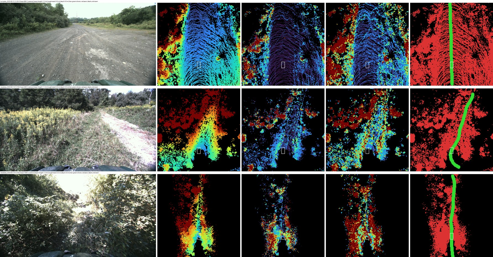

# TartanDrive 2.0: robot-centred BEV grids (elevation, geometry, traversability)

One bird's-eye-view grid per lidar scan, centred on the vehicle, for
TartanDrive 2.0: elevation, a geometric roughness / step layer, and a
self-supervised traversability label from where the vehicle actually drove.

**The point of this dataset is the recipe, not the data.** The grids are
built by the *same* apairo recipe as the RELLIS-3D BEV grids
(`apairo-robotics/rellis3d_bev`): same grid, same past-only accumulation,
same driven corridor, same code (`apairo_huggingface.bev_grid`). Porting it
to TartanDrive took a different apairo declaration (`apairo_bev.yaml`, six
raw channels), the INS attitude as the up axis, and the few numbers the rig
imposes. Everything else -- reading
an asynchronous multi-rate recording, zipping scans with their poses,
materialising three derived channels with recipe-hashed reuse, putting the
camera and the command on the scan clock -- is
[apairo](https://github.com/apairo-robotics/apairo)
(DOI [10.5281/zenodo.23768995](https://doi.org/10.5281/zenodo.23768995)).
Source: `apairo_huggingface.tartan_bev` (`apairo-tartan-bev`), in
[apairo_huggingface](https://github.com/apairo-robotics/apairo_huggingface).



## What was ported, and what changed

| | RELLIS-3D BEV | TartanDrive BEV |
|---|---|---|
| grid | 200 x 200, 0.2 m, 30 m ahead / 10 m behind / 20 m each side | same (shared module) |
| frame | origin at the lidar, +x heading, +y left, z = world z of `poses.txt` | origin at the lidar, +x heading, +y left, z = gravity from the INS attitude at the scan |
| heading in the sensor frame | Ouster -x | vehicle +x |
| heights | lidar z + 1.0 m | lidar z + 1.77 m |
| accumulation | 10 scans, stride 2, past only (1.8 s) | same |
| driven corridor | footprint +-0.7 m, 10 m back / 30 m ahead, all-unknown if < 10 m of path ahead | footprint +-0.8 m (Yamaha Viking), rest same |
| self-returns | 2 m radius + a box behind the lidar | 2 m radius (covers the roof and mounts) |
| per-point labels | yes: `bev_semantic` (majority class) | **none**: replaced by `bev_geometry` (roughness, step) |
| poses | `poses.txt` (csv channel, clock from the camera names) | `gicp_poses` and its `valid_mask.npy` (one per scan, declared on the lidar clock); invalid scans skipped |
| quality check | driven cells vs their class (driveable / obstacle) | driven cells vs their geometry (flat share) |

## Features (10 Hz, one frame per scan; each recording cut into episodes of at most 1000 frames)

| feature | shape / type | content |
|---|---|---|
| `observation.images.front` | (272, 512, 3) video | left multisense camera, rectified, halved; the image nearest the scan (within 0.1 s) |
| `observation.bev.elevation` | (3, 200, 200) float32 | min / max / mean point height in the cell above the ground under the vehicle (m), NaN unknown |
| `observation.bev.geometry` | (2, 200, 200) float32 | `roughness`: std of the point heights in the cell (NaN under 2 points); `step`: largest jump of the mean height to a known 8-neighbour (NaN if none); m |
| `observation.bev.trav` | (200, 200, 3) PNG | 1 driven / 0 seen (a point fell), not driven / 255 unknown; value replicated in the 3 channels |
| `observation.state` | (7,) float32 | GICP pose relative to the episode's first frame, in that frame's vehicle frame (not gravity-aligned), `[x, y, z, qx, qy, qz, qw]` |
| `action` | (2,) float32 | executed forward speed (m/s) and yaw rate (rad/s), from this scan's and the next scan's pose |
| `observation.command` | (2,) float32 | the raw `cmd` channel `[linear, angular]` nearest the scan |
| `observation.frame_info` | (3,) int64 | `[recording_index, scan_index, camera_index]`; recording names in `meta/apairo_recordings.json` |

Grid layout: row 0 is 30 m ahead, column 0 is 20 m left, the vehicle (lidar)
sits at the corner of row 150 / column 100 and drives up the image. Grid
frame: origin at the lidar, z = gravity up from the Novatel INS attitude
(`gps_odom`) at the scan, +x the vehicle heading projected on the plane
normal to it, +y left. Past scans and the driven path are placed relative to
the scan by the GICP poses. The GICP world itself is not used for up: it is
the first scan's vehicle frame and its z drifts from gravity (median 1.0-20.1
deg per recording, 26 deg at worst against the INS).

Elevation and geometry use only the current and past scans (scan j
accumulates j, j-2, ..., j-18); `bev_trav` is a label and uses the future
path. Driven cells are 1 even where no point fell. Scans whose GICP pose is
flagged invalid (`valid_mask.npy`) or that have no INS row within 0.1 s get
all-unknown grids, enter no other grid nor the driven corridor, and are not
exported: 13 scans in all, the 1.2 s in turnpike where the lidar resumes
before the INS after a 12 s gap in the recording (`valid_mask` is true for
all 125,000 poses of the release).

LeRobot's per-element statistics are NaN for the float grids: mask the NaNs
before normalising.

## Stats

13 recordings, every site of the release and both seasons (September and
October-November 2023): 27,561 scans, 46 min of driving, 10.7 km of GICP
path. The full release holds 55 recordings with scans (~125.7k scans).

| recording | scans | repeated | path (km) | frames with trav | driven / seen / unknown | driven observed | driven flat | near (15 m) driven flat | seen-not-driven flat |
|---|---|---|---|---|---|---|---|---|---|
| turnpike_2023-09-12-12-39-19 | 1764 | 149 | 1.15 | 1513 | 0.038 / 0.511 / 0.451 | 0.544 | 0.891 | 0.888 | 0.622 |
| turnpike_flat_2023-09-12-14-21-03 | 2390 | 45 | 0.80 | 2362 | 0.039 / 0.445 / 0.516 | 0.510 | 0.826 | 0.820 | 0.508 |
| turnpike_warehouse_2023-09-13-19-03-05 | 3050 | 32 | 1.46 | 2859 | 0.039 / 0.381 / 0.580 | 0.513 | 0.909 | 0.919 | 0.289 |
| figure_8_morning_slow_2023-09-12-11-06-32 | 1807 | 57 | 0.70 | 1782 | 0.040 / 0.380 / 0.580 | 0.512 | 0.881 | 0.874 | 0.314 |
| figure_8_2023-09-14-11-37-49 | 2999 | 58 | 0.69 | 2961 | 0.039 / 0.294 / 0.667 | 0.455 | 0.623 | 0.621 | 0.194 |
| gupta_skydio_2023-09-14-11-03-09 | 1467 | 7 | 0.50 | 1423 | 0.038 / 0.393 / 0.569 | 0.414 | 0.807 | 0.777 | 0.361 |
| warehouse_gupta_2023-09-13-16-28-57 | 1831 | 9 | 0.98 | 1798 | 0.040 / 0.421 / 0.539 | 0.514 | 0.888 | 0.899 | 0.401 |
| meadows_2023-09-14-12-18-22 | 2255 | 28 | 0.62 | 2160 | 0.038 / 0.284 / 0.678 | 0.423 | 0.569 | 0.582 | 0.182 |
| slag_heap_2023-09-14-12-23-05 | 1711 | 8 | 0.23 | 1544 | 0.037 / 0.329 / 0.634 | 0.408 | 0.685 | 0.692 | 0.232 |
| sam_loop_2023-09-27-13-04-54 | 1252 | 7 | 0.82 | 1236 | 0.040 / 0.380 / 0.580 | 0.513 | 0.892 | 0.900 | 0.222 |
| 2023-11-02-16-00-43_down_meadows | 2155 | 4 | 0.72 | 1790 | 0.039 / 0.409 / 0.553 | 0.514 | 0.869 | 0.880 | 0.309 |
| 2023-11-14-14-34-53_gupta | 2610 | 5 | 1.14 | 2533 | 0.040 / 0.462 / 0.499 | 0.496 | 0.885 | 0.885 | 0.458 |
| 2023-11-14-15-22-01_figure_8 | 2270 | 4 | 0.90 | 2077 | 0.039 / 0.409 / 0.552 | 0.449 | 0.807 | 0.790 | 0.282 |
| **all** | **27561** | **413** | **10.7** | **26038** | **0.039 / 0.389 / 0.572** | **0.483** | **0.811** | **0.808** | **0.350** |

"Flat" = roughness < 0.10 m and step < 0.20 m (both known); shares of flat
are over cells where both are known. The driven corridor is flat in 81% of
its observed cells against a 35% base rate in the seen-not-driven cells
(ratio 2.3x; 1.4x to 4.0x per recording). Each criterion alone: roughness
0.909, step 0.839. The lowest shares are the vegetated recordings (meadows
0.569, figure_8 0.623, slag heap 0.685), where the Viking drives through grass
and brush that reads rough: the proxy is geometric, not a label. Half the
driven cells hold no point (0.483 observed), as on RELLIS (0.65-0.69): the
unseen disc around the vehicle and the hidden rear. Frames with less than
10 m of path ahead (1523, mostly stops and recording ends) have an all-unknown
trav grid.

### Levelling check (against GPS altitude)

Independent of the lidar and of GICP's vertical: every 10th scan j, take the
pose the vehicle reaches 15-25 m of path later, read the lowest point height
of the grid of scan j in the 5 x 5 cells around that spot, and compare it
with the GPS altitude change between the two instants (the ground under the
vehicle then, seen from now). The same grids levelled with GICP's world z
against the INS gravity they use:

| recording | samples | GICP z: median / p90 abs error (m) | INS gravity: median / p90 abs error (m) |
|---|---|---|---|
| turnpike_2023-09-12-12-39-19 | 147 | 1.14 / 3.18 | 0.24 / 0.65 |
| turnpike_flat_2023-09-12-14-21-03 | 214 | 0.39 / 0.69 | 0.17 / 0.49 |
| turnpike_warehouse_2023-09-13-19-03-05 | 264 | 0.55 / 1.21 | 0.27 / 0.57 |
| figure_8_morning_slow_2023-09-12-11-06-32 | 170 | 0.91 / 1.48 | 0.17 / 0.42 |
| figure_8_2023-09-14-11-37-49 | 261 | 1.49 / 7.77 | 0.30 / 1.08 |
| gupta_skydio_2023-09-14-11-03-09 | 94 | 0.33 / 0.66 | 0.16 / 0.70 |
| warehouse_gupta_2023-09-13-16-28-57 | 161 | 1.22 / 1.94 | 0.22 / 0.91 |
| meadows_2023-09-14-12-18-22 | 165 | 2.13 / 4.39 | 0.18 / 0.71 |
| slag_heap_2023-09-14-12-23-05 | 121 | 0.73 / 1.43 | 0.30 / 1.07 |
| sam_loop_2023-09-27-13-04-54 | 109 | 1.48 / 1.85 | 0.15 / 0.45 |
| 2023-11-02-16-00-43_down_meadows | 157 | 4.70 / 7.40 | 0.19 / 0.50 |
| 2023-11-14-14-34-53_gupta | 228 | 0.56 / 0.82 | 0.14 / 0.33 |
| 2023-11-14-15-22-01_figure_8 | 177 | 2.14 / 3.24 | 0.16 / 0.46 |

The median error drops from 0.33-4.70 m to 0.14-0.30 m per recording; the
remaining -0.1 to -0.2 m bias is the lowest point of a cell sitting a little
under the mean ground.

### Export check (local LeRobotDataset, reloaded)

`apairo-tartan-bev check` on the written dataset: 34 episodes, 27,135 frames
(= 27,561 scans - 413 repeats - 13 invalid; no frame dropped by the 0.1 s camera / cmd
tolerance). Recordings are cut into equal consecutive episodes of at most
1000 frames (622-981 here), because LeRobot holds an episode's float grids in
memory (9.0 GB peak RSS for 1000-frame episodes);
`meta/apairo_recordings.json` maps episodes back to recordings and
`observation.frame_info` to scans.

| check | value |
|---|---|
| trav values | {0, 1, 255}; cells 3.7% driven / 36.9% seen / 59.4% unknown (all frames, incl. all-unknown ones) |
| elevation known share | 0.404 (every 50th frame) |
| mean height p1 / p50 / p99 | -2.38 / 0.62 / 7.50 m, all cells (trees, slopes; not terrain-normalised); driven cells only: -3.31 / -0.02 / 3.14 m |
| roughness p50 / p99 | 0.082 / 1.82 m |
| step p50 / p99 | 0.247 / 4.20 m |
| action forward speed p1 / p50 / p99 | -0.10 / 3.75 / 10.65 m/s (6 frames > 15 m/s: scan stamp jitter, see limitations; 100 < -1 m/s: reversing) |
| yaw rate range | -1.98 / 1.53 rad/s |
| command range | linear [0, 1], angular [-1, 1] |

Sizes: 12 GB of apairo grids (440 KB per scan) + 5.8 GB LeRobot (5.3 GB
parquet, 504 MB video) = 17.8 GB for the subset; the full release would be
~55 GB + ~26 GB. Time: ~13 min to process (three recordings in parallel,
190 MB RSS each), 21 min to export.

## Known limitations

- **Heights are not terrain-normalised.** They are relative to the ground
  under the vehicle along gravity: on a climb the ground ahead reads high
  (that is the terrain, see the levelling check). Use `step` / `roughness`
  for local geometry.
- **Up comes from the INS, placement from GICP.** The INS attitude is taken
  as the vehicle's (no mount offset applied; it agrees with lidar ground-plane
  normals to under 1 deg on average). Over the 40 m a grid spans, GICP's own
  slow tilt drift is negligible.
- **Behind the vehicle is mostly unknown**: the cab hides the rear from the
  roof lidar, and no point falls within 2 m.
- **Vegetation reads rough.** Tall grass the Viking drives through has high
  roughness / step: the flat share is a conservative proxy of driveable, not
  a label.
- **Accumulation smears** moving objects and pose drift over 1.8 s; ring
  patterns in the step layer come from scans placed a few cm apart in z.
- **Repeated scans.** The source repeats some scans under the same stamp
  (identical points; 4-149 per recording here, 413 in all); apairo keeps one grid per scan,
  the LeRobot export keeps the first of each repeat.
- **`cmd` linear is almost always 0**: in 10 of the 13 recordings it is 0
  throughout, in two it is nonzero in < 0.3% of the rows, only in sam_loop is
  it set (88%); the angular part is the steering command in [-1, 1]. `action`
  therefore comes from the poses, and `cmd` is kept as `observation.command`.
  The `action` of `apairo-robotics/tartandrive_offroad` is this `cmd`.
- **Scan stamp jitter.** `action` divides the pose step by the scan stamp
  difference, which is sometimes 0.02-0.07 s instead of 0.1 s: the 6 frames
  above 15 m/s are such frames (the displacement matches the neighbouring
  speed in 5 of them), not invalid poses. `action` is not filtered.
- **A subset.** 13 of the 55 recordings with scans (see Stats); the full set
  is ~125.7k scans.

## Reproduce

```bash
pip install -e ../apairo -e ../apairo_preprocess -e ../apairo_transform -e ".[test]"
apairo-tartan-bev process --root /path/to/tartan --out ~/data/tartan_bev          # the 13 recordings of config.SEQUENCES
apairo-tartan-bev render ~/data/tartan_bev/turnpike_2023-09-12-12-39-19 --every 500 --png-dir /tmp/tbev
apairo-tartan-bev quality --out ~/data/tartan_bev
apairo-tartan-bev export ~/data/tartan_bev --lerobot-root ~/data/tartan_bev_lerobot
apairo-tartan-bev check ~/data/tartan_bev_lerobot
```

`--root` is the TartanDrive 2.0 tree in the apairo layout (one directory per
recording with `velodyne_0/`, `gicp_poses/`, `image_left_color/`, `cmd/`, as
written by [apairo_extractor](https://github.com/apairo-robotics/apairo_extractor)
from the rosbags; the GICP poses are those of the source). It is only read:
each recording is a symlink view under `--out`, where apairo writes the
derived channels and its registry.

## Source data

TartanDrive 2.0 was collected at Carnegie Mellon University's AirLab with a
modified Yamaha Viking ATV driven across diverse off-road terrain. The
recordings are the rosbag distribution converted to the apairo layout, the
same tree that produced `apairo-robotics/tartandrive_offroad`.

## Citation

TartanDrive 2.0:

```bibtex
@inproceedings{sivaprakasam2024tartandrive,
  title={TartanDrive 2.0: More Modalities and Better Infrastructure to Further Self-Supervised Learning Research in Off-Road Driving Tasks},
  author={Sivaprakasam, Matthew and Maheshwari, Parv and Castro, Mateo Guaman and Triest, Samuel and Nye, Micah and Willits, Steve and Saba, Andrew and Wang, Wenshan and Scherer, Sebastian},
  booktitle={IEEE International Conference on Robotics and Automation (ICRA)},
  year={2024}
}
```

apairo (the pipeline):

```bibtex
@software{bresset2026apairo,
  title={apairo: a unified loader for robotics sensor datasets},
  author={Bresset, Augustin},
  year={2026},
  version={0.9.0},
  doi={10.5281/zenodo.23768995},
  url={https://github.com/apairo-robotics/apairo}
}
```

## License

The original [TartanDrive dataset](https://theairlab.org/tartandrive-dataset/)
is explicitly released under
[CC BY 4.0](http://creativecommons.org/licenses/by/4.0/). TartanDrive 2.0 does
not state a separate data license (its repository's MIT license covers the
code); this derived dataset is published under CC BY 4.0 accordingly, with
full attribution to the AirLab authors above. The conversion code
([apairo_huggingface](https://github.com/apairo-robotics/apairo_huggingface))
is MIT.
